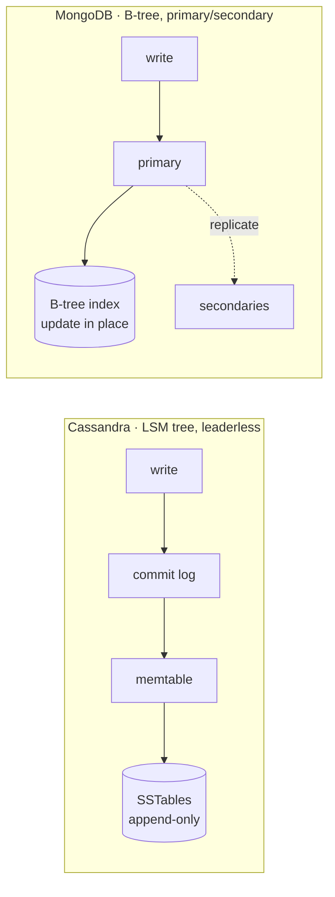

<div align="center">

# Cassandra vs MongoDB

**A hands-on benchmark on NYC taxi data: 1 million trips loaded from a 13-million-trip dataset**


</div>

> **TL;DR:** On a single VM, Cassandra wins at one thing, sequential writes (2.2× faster, with a concurrency caveat below). MongoDB wins at the rest: bulk deletes (~35× faster per row), aggregations (5× faster) and schema changes (no migration needed). The biggest lesson was that my first benchmark was wrong, and why.

<br>

## Results

The source data is four months of NYC Yellow Taxi trips (Jan–Apr 2024, 13,069,067 records). The first **1,000,000 rows** were loaded into each database on the same GCP VM, then four workloads were run once each:

| Workload | Cassandra | MongoDB | Winner |
|:--|--:|--:|:-:|
| **Sequential writes**: 500K single inserts, like sensor data | **107.7 s · 4,642 / s** | 238 s · 2,101 / s | Cassandra · 2.2× |
| **Bulk delete**: all trips with fare < $10 | 252.1 s for 300,871 rows (≈1,200 / s) | **8.2 s for 345,966 rows (≈42,000 / s)** | MongoDB · ~35× per row |
| **Aggregation**: average fare and total revenue for every pickup zone | 7.7 s (read, then aggregate in Python) | **1.5 s** (aggregation pipeline) | MongoDB · 5× |
| **Schema evolution**: add `surge_pricing` and `peak_hour` to matching records | `ALTER TABLE` 1.05 s, but no conditional update | **5.9 s, 338K documents updated, no schema change** | MongoDB |

### Caveats (read before quoting these numbers)

- **Single runs on one node.** Each workload ran once, so there is no variance estimate, and Cassandra's leaderless design pays off on a cluster, not a single VM.
- **Unequal write concurrency.** Cassandra used `execute_async` with up to 500 writes in flight; MongoDB used `insert_one`, one write at a time. A fair rerun would give MongoDB the same concurrency (a thread pool, or unordered `insert_many` in batches of 500).
- **The deletes removed different rows.** CQL can only delete by primary key, so Cassandra's delete was a client-side scan-check-delete loop, and the two databases ended up deleting different numbers of rows (300,871 vs 345,966). That's why the comparison is per row.

## Why the numbers look like this



- **Writes favour Cassandra.** Every write is an append, so nothing is looked up or rewritten.
- **Deletes favour MongoDB.** Cassandra can't delete in place: it writes a *tombstone* for every row, which compaction cleans up later.
- **Aggregations favour MongoDB.** CQL has no `GROUP BY` across partitions, so the work moves to the client. MongoDB runs it inside the database with its aggregation pipeline.

## The mistake that taught me the most

My first run showed Cassandra *losing* on writes, which contradicts every paper on the subject. The cause was the synchronous driver calls I'd used, which wait for a round trip on every insert. Switching to **`execute_async`** brought the results in line with the literature. How you use a database matters as much as which one you pick.

## When to pick which

| Pick **Cassandra** for | Pick **MongoDB** for |
|:--|:--|
| Write-heavy, always-on, multi-region systems | Flexible or evolving schemas |
| IoT, event logs, time series | Ad-hoc queries and in-database analytics |
| Query patterns known up front | Fast product iteration |

## Quickstart

```bash
pip install -r requirements.txt
# Start Cassandra (9042) and MongoDB (27017) locally or on a VM
# Download NYC TLC Yellow Taxi parquet files (Jan–Apr) as taxi_jan.parquet … taxi_apr.parquet
python benchmark.py
```

<p align="center"><br><sub>Loading 1M base rows into both databases</sub></p>

## What I'd do next

- Run each workload **5+ times and report p50/p95**, not single runs
- Re-run writes with **matched concurrency** on both sides
- Test on a **3-node cluster**, where Cassandra's leaderless design should pull ahead
- Add **read-heavy** and **mixed** workloads (YCSB A–F) for a fuller picture

<br>

<sub>📄 Full write-up: <a href="report/report.pdf">report/report.pdf</a> · Boston University MET CS 777, Big Data Analytics, Spring 2026</sub>
