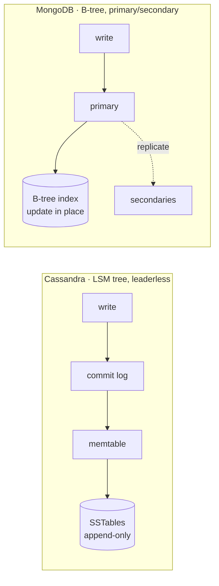

<div align="center">

# Cassandra vs MongoDB

**A hands-on benchmark on 13 million NYC taxi trips**


</div>

> **TL;DR:** Cassandra wins at one thing, sequential writes (2.2× faster). MongoDB wins at the rest: deletes (~30× faster), aggregations (5× faster) and schema changes (no migration needed). The biggest lesson was that my first benchmark was wrong, and why.

<br>

## Results

1,000,000 NYC Yellow Taxi rows loaded into each database on the same GCP VM, then four workloads:

| Workload | Cassandra | MongoDB | Winner |
|:--|--:|--:|:-:|
| **Sequential writes**: 500K single inserts, like sensor data | **4,642 / s** | 2,101 / s | Cassandra · 2.2× |
| **Bulk delete**: ~346K records | 4+ min | **8 s** | MongoDB · ~30× |
| **Aggregation**: stats across every pickup zone | 1× | **5×** | MongoDB |
| **Schema evolution**: add fields to existing records | `ALTER TABLE`, no conditional updates | **just write them** | MongoDB |

## Why the numbers look like this



- **Writes favour Cassandra.** Every write is an append, so nothing is looked up or rewritten.
- **Deletes favour MongoDB.** Cassandra can't delete in place: it writes a *tombstone* for every row, which compaction cleans up later.
- **Aggregations favour MongoDB.** CQL has no `GROUP BY` across partitions, so the work moves to the client. MongoDB runs it inside the database with its aggregation pipeline.

## The mistake that taught me the most

My first run showed Cassandra *losing* on writes, which contradicts every paper on the subject. The cause was the synchronous driver calls I'd used, which wait for a round trip on every insert. Switching to **`execute_async`** brought the results in line with the literature. How you use a database matters as much as which one you pick.

## When to pick which

| Pick **Cassandra** for | Pick **MongoDB** for |
|:--|:--|
| Write-heavy, always-on, multi-region systems | Flexible or evolving schemas |
| IoT, event logs, time series | Ad-hoc queries and in-database analytics |
| Query patterns known up front | Fast product iteration |

## Quickstart

```bash
pip install pandas pyarrow cassandra-driver pymongo
# Start Cassandra (9042) and MongoDB (27017) locally or on a VM
# Download NYC TLC Yellow Taxi parquet files (Jan–Apr) as taxi_jan.parquet … taxi_apr.parquet
python benchmark.py
```

<p align="center"><br><sub>Loading 1M base rows into both databases</sub></p>

## What I'd do next

- Run each workload **5+ times and report p50/p95**, not single runs
- Test on a **3-node cluster**, where Cassandra's leaderless design should pull ahead
- Add **read-heavy** and **mixed** workloads (YCSB A–F) for a fuller picture

<br>

<sub>📄 Full write-up: <a href="report/report.pdf">report/report.pdf</a> · Boston University MET CS 777, Big Data Analytics, Spring 2026</sub>
